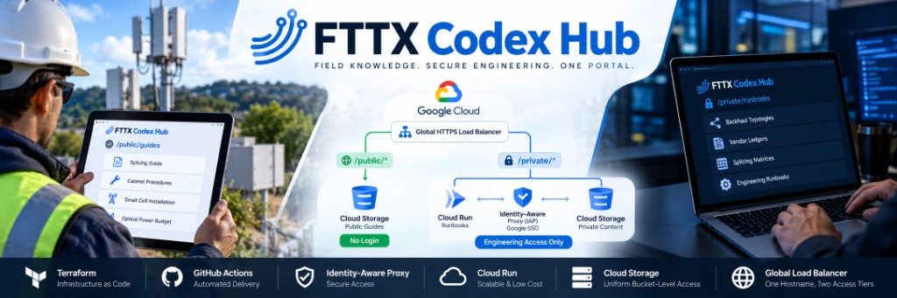
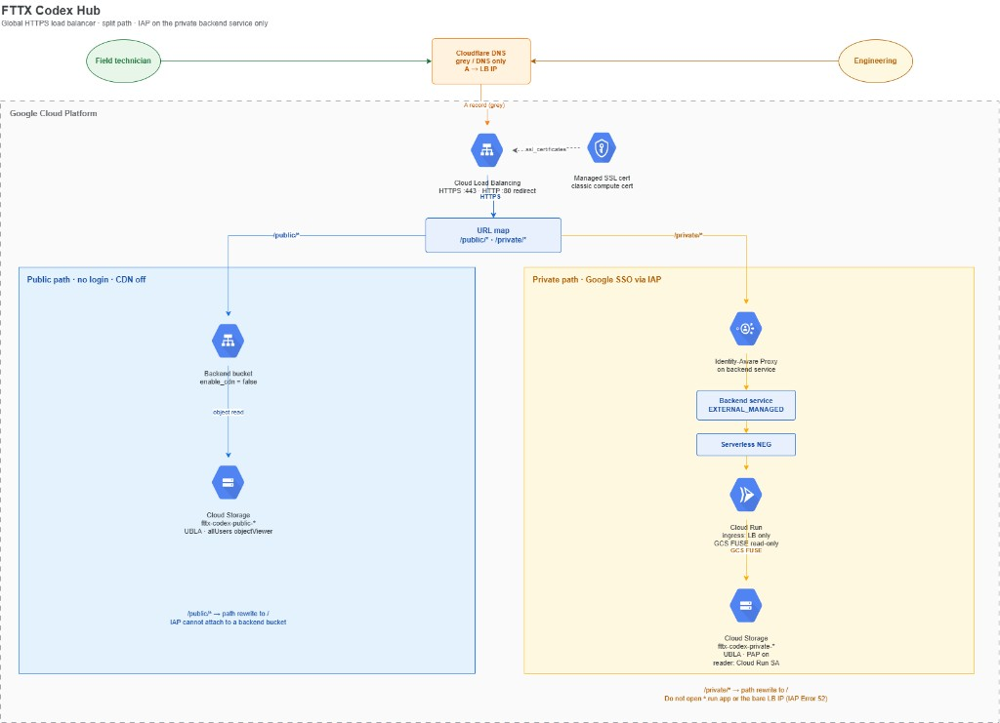
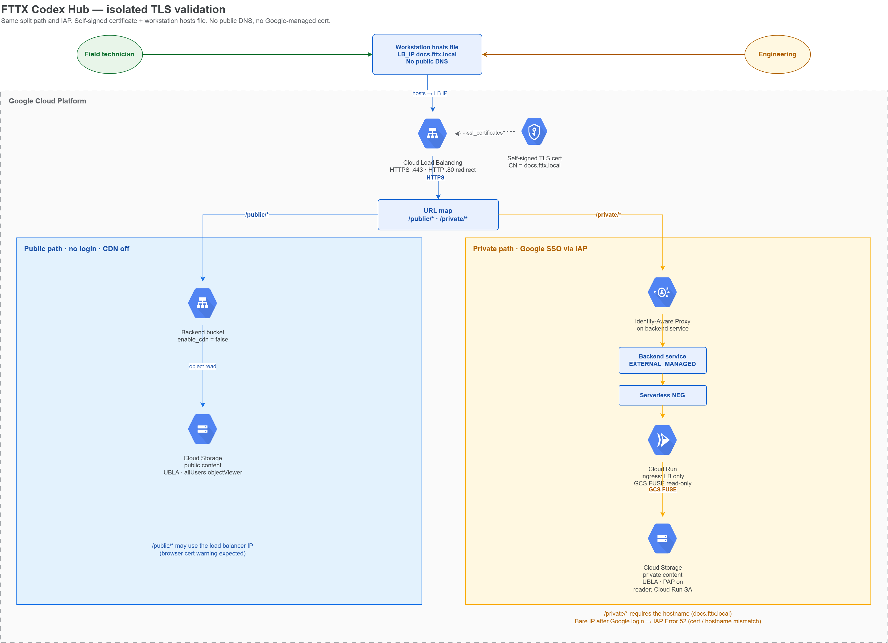
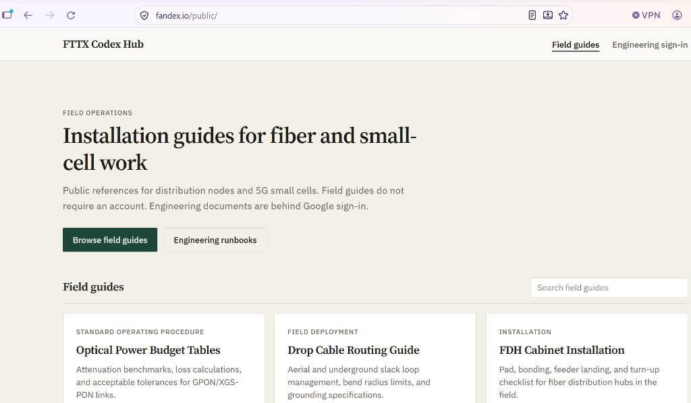
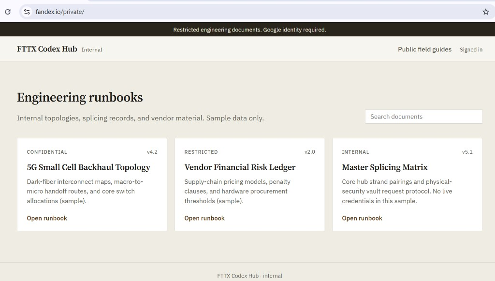
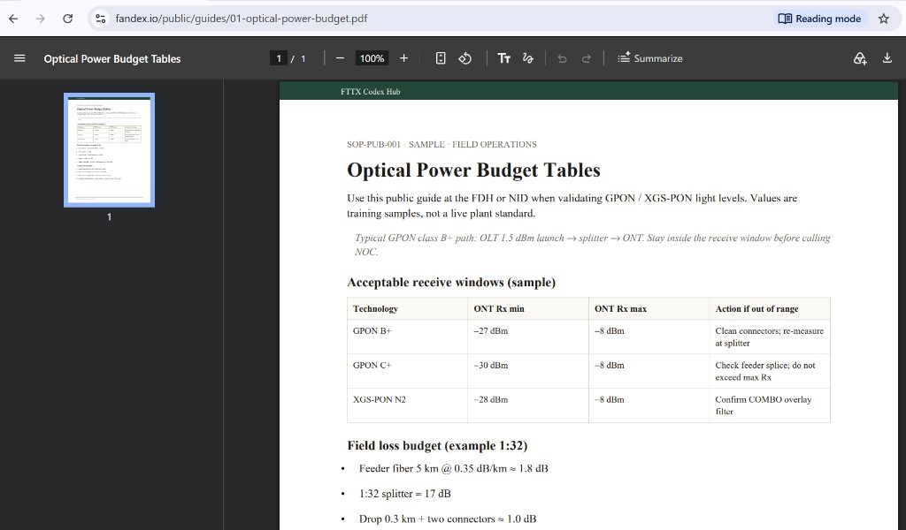
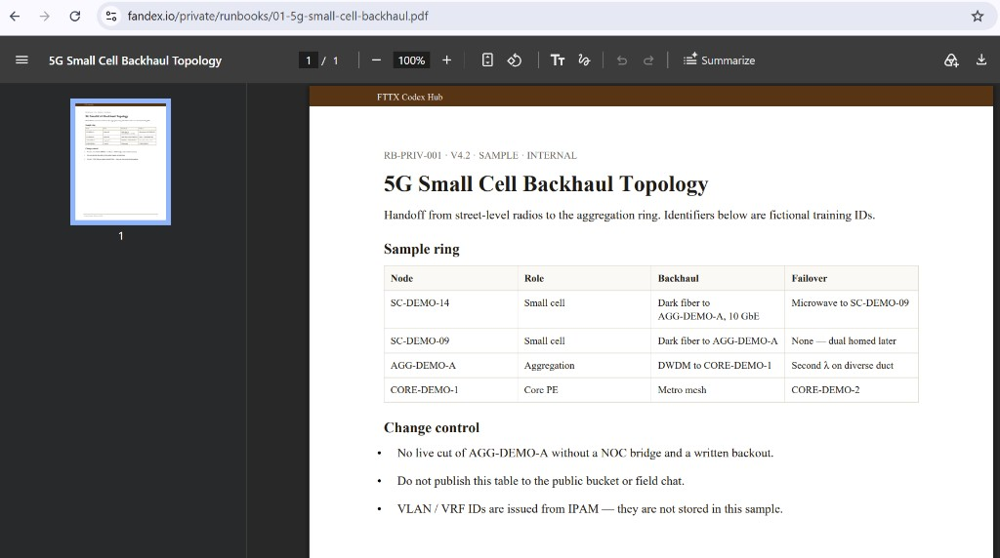

# FTTX Codex Hub

A hybrid-access documentation portal for fiber and small-cell field operations: installation guides with no login, proprietary runbooks behind Google identity.

This public repository describes the implemented system: the business problem, the architecture that shipped, and the operational result. Terraform, IAM bindings, CI workflows, and other implementation artifacts stay in a private repository.

---

## Business problem

Field crews deploying FTTX distribution nodes and 5G small cells need splicing primers and cabinet procedures on a tablet, often on a shared device, without an engineering account.

Engineering still needs identity-based control over backhaul topologies, vendor ledgers, and splicing matrices. Putting those files behind the same login wall as a drop-cable guide slows the field. Publishing them as public Cloud Storage links, or mixing both tiers in one bucket with object ACLs, creates audit gaps: a single object can be world-readable while the container looks private.

Manual portal updates also drift. The field copy is not the engineering standard.

**Objectives**

- One hostname, two access tiers.
- No object ACLs. Uniform Bucket-Level Access on every bucket.
- Private objects never reachable as `storage.googleapis.com` URLs.
- Infrastructure and content releases as code (Terraform + GitOps), not manual console uploads.

---

## Solution

A global external HTTPS load balancer on Google Cloud with path-based routing:

| Path | Audience | Access | Backend |
| --- | --- | --- | --- |
| `/public/*` | Field technicians | None | GCS **backend bucket** (CDN off) |
| `/private/*` | Engineering | Google SSO via Identity-Aware Proxy | **Backend service** → serverless NEG → Cloud Run (ingress: load balancer only) → private GCS via FUSE |

IAP cannot attach to a GCS backend bucket. It attaches to a backend service. That GCP constraint is why the private path is Cloud Run, not “IAP on the second bucket.”

A single bucket cannot host both tiers under Uniform Bucket-Level Access: `allUsers` is bucket-wide. Two buckets give each tier its own perimeter.

---

## Architecture

### Production: managed certificate and public DNS

DNS A records point the hostname at the load balancer (DNS only, not proxied). Google issues a classic managed SSL certificate. HTTP :80 redirects to HTTPS. The URL map splits `/public/*` and `/private/*`.

### Isolated TLS validation: self-signed certificate

Same split path, IAP, Cloud Run, and storage. TLS is a self-signed certificate; name resolution is a workstation hosts file. No public DNS and no Google-managed cert.

This is how the URL map and IAP hostname binding were proven **before** a public domain was attached. `/public/` can use the load balancer IP (browser certificate warning). `/private/` requires the hostname; using the bare IP after Google login fails because the certificate does not match the name.

---

## What it looks like in production

Screenshots use **`fandex.io` as an example hostname** to demonstrate `/public/` and `/private/`. It is not a required domain, and it is not expected to resolve unless that implementation is running.

Unauthenticated field index:

Restricted runbooks after Google sign-in:

Public guide served through `/public/guides/`:

Private runbook served through `/private/runbooks/` (IAP):

---

## Technology stack

| Area | Choice |
| --- | --- |
| Cloud | Google Cloud Platform |
| Edge | Global external Application Load Balancer, URL map, HTTP→HTTPS |
| TLS | Google-managed classic SSL certificate (production); self-signed for isolated validation |
| DNS | Authoritative DNS, DNS-only (not proxied) A records to the anycast IP |
| Public content | Cloud Storage backend bucket, Uniform Bucket-Level Access, `allUsers` objectViewer, Cloud CDN **off** |
| Private content | Cloud Storage (public access prevention), Cloud Run Gen2, GCS FUSE read-only, serverless NEG |
| Identity | Identity-Aware Proxy on the private **backend service**, Google Group as `iap.httpsResourceAccessor` |
| Automation | Terraform (IaC), GitHub Actions with Workload Identity Federation (no JSON keys), content sync on merge |
| Networking / security | IAP at the Google front end, Cloud Run ingress restricted to the load balancer, no object ACLs |

---

## Implementation approach

- **Design constraint first.** IAP on a backend bucket is unsupported. The architecture follows that rule instead of fighting it.
- **Two perimeters.** Public and private content never share a bucket. Misconfiguring field-guide IAM cannot expose runbooks.
- **Identity at the edge.** IAP evaluates Google login before Cloud Run. The Cloud Run default URL is not a public bypass.
- **GitOps.** Terraform owns buckets, IAM, load balancer, URL map, Cloud Run, IAP, and certificates. PDFs and HTML are synced into buckets; they are not declared as individual Terraform objects.
- **CI identity.** GitHub authenticates to GCP with Workload Identity Federation. Service-account JSON keys are not used.
- **Cost.** No Cloud CDN. Cloud Run scales to zero. The standing cost is the global HTTPS forwarding rule.

---

## Business value

| Outcome | How it shows up |
| --- | --- |
| Lower MTTR | Installation guides load with no account, including on shared tablets |
| Controlled engineering access | Runbooks require Google SSO and group membership; denied users never reach the private bucket |
| No object-ACL drift | Uniform Bucket-Level Access on both buckets; private objects are not world-readable |
| Repeatable delivery | Full stack is declared in Terraform; content updates ship with a merge, not a console upload |
| Hostname and certificate agree | Isolated self-signed validation first, then a Google-managed certificate on the real hostname so IAP and the browser match |

Private objects remain inaccessible at the storage API URL. Unauthenticated clients reach `/public/` and are challenged on `/private/`.
